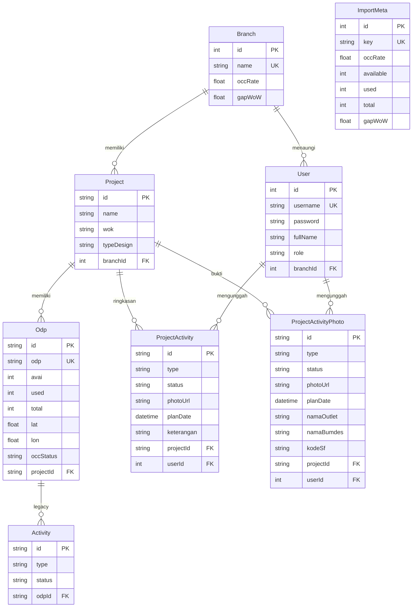

# Dokumentasi Backend & Database — GTM Activity Monitoring Jateng DIY

> Referensi lengkap sisi **backend** dan **database** untuk penyusunan Laporan Kerja Praktik.
> Repositori `gayeng-gtm` · nomor baris mengacu pada commit `9338241` · link dapat diklik di VS Code.

## Daftar Isi

1. [Gambaran Umum & Istilah](#1-gambaran-umum--istilah)
2. [Arsitektur Sistem](#2-arsitektur-sistem)
3. [Teknologi Backend](#3-teknologi-backend)
4. [Struktur Folder & Pemisahan Kode](#4-struktur-folder--pemisahan-kode)
5. [Instalasi, Konfigurasi & Menjalankan](#5-instalasi-konfigurasi--menjalankan)
6. [Peta Isi `server.js`](#6-peta-isi-serverjs)
7. [Middleware & Fungsi Helper](#7-middleware--fungsi-helper)
8. [Referensi REST API (19 endpoint)](#8-referensi-rest-api)
9. [Database](#9-database)
10. [Penyimpanan di Luar Database](#10-penyimpanan-di-luar-database)
11. [Proses Bisnis Backend Secara Rinci](#11-proses-bisnis-backend-secara-rinci)
12. [Keamanan](#12-keamanan)
13. [Keandalan, Deployment & Performa](#13-keandalan-deployment--performa)
14. [Pembagian Perhitungan Backend vs Frontend](#14-pembagian-perhitungan-backend-vs-frontend)
15. [Temuan, Kendala & Saran Pengembangan](#15-temuan-kendala--saran-pengembangan)
16. [Riwayat Pengembangan & Kontribusi](#16-riwayat-pengembangan--kontribusi)

---

## 1. Gambaran Umum & Istilah

**GTM Activity Monitoring – Jateng DIY** memantau dua hal untuk wilayah Jawa Tengah & DIY:

1. **Okupansi port ODP** per proyek / WOK / Branch, dari file Excel mingguan yang diimpor admin.
2. **Kegiatan GTM** per proyek (5 jenis), dibuktikan dengan foto yang diunggah user WOK lalu diverifikasi admin.

Fitur pendukung: **tracking program bulanan** (gambar + OCR link, atau Excel) dan **pencarian data Tsel One Pairing**.

**Peran backend:** menyediakan REST API, autentikasi & otorisasi, validasi, penyimpanan data ke PostgreSQL, pengelolaan foto (Cloudinary → disk lokal), parsing Excel, OCR, dan indeks pencarian.

### Glosarium

| Istilah | Arti |
|---|---|
| **ODP** (Optical Distribution Point) | Titik distribusi jaringan fiber yang memiliki sejumlah port pelanggan |
| **Port avai / used / total** | Port tersedia / terpakai / kapasitas total |
| **OCC (Occupancy Rate)** | Persentase port terpakai = used ÷ total |
| **GAP WoW** | Selisih nilai minggu ini dengan minggu lalu (*Week-on-Week*) |
| **Branch** | Cabang: MAGELANG, PEKALONGAN, PURWOKERTO, SEMARANG, SURAKARTA, YOGYAKARTA |
| **WOK** | Wilayah Operasional Kerja, sub-wilayah di bawah branch (mis. KEBUMEN, YOGYA 1) |
| **Greenfield / Brownfield** | Tipe desain proyek: area baru / area yang sudah ada jaringannya |
| **Kegiatan GTM** | `tsel_menyapa` (Tsel Menyapa Warga), `branding_outlet` (Branding Downline/Outlet), `bumdes` (Kerjasama BUMDes), `rekrutmen_sf` (Rekrutmen SF AKAMSI), `open_table` (Always On Open Table) |
| **Tsel One Pairing** | Data pasangan layanan rumah (IndiHome/BB ID) dengan nomor seluler (MSISDN parent & child) |
| **MSISDN** | Nomor telepon seluler (format `08…` atau `628…`) |
| **BB ID / Order ID** | ID layanan broadband / ID pesanan |

### Peran pengguna

| Role | Hak akses di backend |
|---|---|
| **ADMIN** | Semua endpoint: verifikasi/tolak, impor Excel ODP, reset kegiatan, kelola program & pairing, register user |
| **USER** (akun WOK, terikat 1 branch) | Upload & hapus bukti kegiatan **hanya di branch-nya**, cari pairing, baca data |
| **Tanpa login** | Hanya `GET /api/data`, `/api/import-meta`, `/api/programs`, `/api/health`, login & reset password |

---

## 2. Arsitektur Sistem

### 2.1 Pola arsitektur

- **Client–Server** dengan **REST API** (JSON; `multipart/form-data` untuk upload file).
- **Three-tier architecture**:

  | Tier | Isi | Teknologi |
  |---|---|---|
  | Presentation | Single Page Application | React 19 + Vite (dikerjakan frontend) |
  | Application / Logic | REST API, autentikasi, validasi, pemrosesan Excel, OCR, pengelolaan foto | Node.js + Express 5 |
  | Data | Basis data relasional + penyimpanan berkas | PostgreSQL (Neon) via Prisma, Cloudinary, file system lokal |

- **Monorepo** (backend & frontend dalam satu repositori, folder terpisah).
- **Monolithic backend**: semua endpoint ada di satu file [server.js](../gtm-monitor-backend/server.js).
- **Stateless authentication**: server tidak menyimpan sesi; identitas dibawa oleh token JWT pada setiap request.
- **Hybrid storage**: data terstruktur di PostgreSQL, foto di Cloudinary/disk, data semi-terstruktur (program, pairing) di file JSON.

### 2.2 Diagram arsitektur

```
                ┌───────────────────────────────────────────┐
                │  Browser Pengguna (Admin / User WOK)      │
                │  React SPA (hasil build Vite)             │
                └──────────────────┬────────────────────────┘
                                   │ HTTPS · fetch() · JSON / multipart
                                   │ Header: Authorization: Bearer <JWT>
                ┌──────────────────▼────────────────────────┐
                │  Cloudflare Tunnel (cloudflared)          │  ← akses publik ke server lokal
                └──────────────────┬────────────────────────┘
                                   │
┌──────────────────────────────────▼─────────────────────────────────────────┐
│  SERVER BACKEND — Node.js + Express 5  (port 3001)                         │
│  Dikelola PM2 (auto-restart) + watchdog.js (health check tiap 45 detik)   │
│                                                                            │
│  Middleware : cors → express.json → static → authenticateToken /          │
│               requireAdmin → multer (upload file ke memori)                │
│  Routing    : /api/auth/*  /api/data  /api/activities  /api/verify ...     │
│  Static     : /database foto/*  /uploads/*  + SPA (gtm-monitor-react/dist) │
│                                                                            │
│   ┌─────────────┐  ┌──────────────┐  ┌────────────┐  ┌──────────────────┐  │
│   │ Prisma ORM  │  │ Cloudinary   │  │ SheetJS    │  │ Tesseract.js     │  │
│   │             │  │ SDK          │  │ (xlsx)     │  │ (OCR)            │  │
│   └──────┬──────┘  └──────┬───────┘  └────────────┘  └──────────────────┘  │
│          │                │          File system lokal:                    │
│          │                │          • database foto/<BRANCH>/<WOK>/...    │
│          │                │          • data/programs/index.json + .xlsx    │
│          │                │          • data/pairing/records.json, meta.json│
└──────────┼────────────────┼────────────────────────────────────────────────┘
           │                │
┌──────────▼─────────┐ ┌────▼──────────────────────────┐
│ PostgreSQL (Neon)  │ │ Cloudinary (cloud storage)    │
│ 8 tabel            │ │ • gtm_staging  : foto belum   │
│                    │ │   diverifikasi                │
│                    │ │ • gtm_programs : gambar       │
│                    │ │   tracking program            │
└────────────────────┘ └───────────────────────────────┘
```

### 2.3 Alur sebuah request (request lifecycle)

```
Request masuk
  │
  ├─► cors()                     – tambahkan header CORS
  ├─► express.json()             – parse body JSON → req.body
  ├─► express.static(...)        – jika path /uploads atau /database foto → kirim file, selesai
  ├─► Route handler yang cocok:
  │     ├─ authenticateToken     – verifikasi JWT → req.user   (401 jika gagal)
  │     ├─ requireAdmin          – cek req.user.role==='ADMIN' (403 jika bukan)
  │     ├─ multer.single(...)    – parse multipart → req.file (buffer) + req.body
  │     └─ logika bisnis         – validasi → Prisma / Cloudinary / fs → res.json(...)
  ├─► app.use('/api', 404)       – endpoint API tak dikenal → JSON 404
  ├─► error middleware           – error tak tertangkap → JSON {error}
  └─► static SPA + fallback      – selain itu kirim index.html React (production)
```

### 2.4 Mode menjalankan

| Mode | Perintah (root) | Keterangan |
|---|---|---|
| Development | `npm run dev` | `concurrently` menjalankan backend (port 3001) + Vite (port 5173). Vite mem-*proxy* `/api` & `/uploads` ke backend ([vite.config.js](../gtm-monitor-react/vite.config.js)). |
| Production | `npm run pm2:start` | PM2 menjalankan `gtm-backend` + `gtm-watchdog` ([ecosystem.config.js](../ecosystem.config.js)). Backend juga menyajikan build React dari `gtm-monitor-react/dist` ([server.js:2764-2770](../gtm-monitor-backend/server.js#L2764-L2770)) → frontend & API satu origin. Akses publik lewat Cloudflare Tunnel. |

---

## 3. Teknologi Backend

### 3.1 Runtime, framework & library

Versi terpasang: Node.js **v24.14.1**, Express **5.2.1**, Prisma **5.22.0**.

| Teknologi | Versi | Kategori | Fungsi dalam sistem | Lokasi |
|---|---|---|---|---|
| **Node.js** | 24.x | Runtime | Menjalankan JavaScript di server (modul CommonJS / `require`) | seluruh backend |
| **Express** | ^5.2.1 | Web framework | Routing REST API, middleware, file statis | [server.js:43](../gtm-monitor-backend/server.js#L43) |
| **Prisma ORM** (`prisma` CLI + `@prisma/client`) | ^5.22.0 | ORM | Definisi skema, sinkronisasi skema ke DB, query type-safe | [schema.prisma](../gtm-monitor-backend/prisma/schema.prisma), [server.js:44-50](../gtm-monitor-backend/server.js#L44-L50) |
| **PostgreSQL (Neon)** | – | DBMS | Basis data relasional *serverless* di cloud | `DATABASE_URL` |
| **jsonwebtoken** | ^9.0.3 | Keamanan | Membuat & memverifikasi JWT (masa berlaku 8 jam) | [server.js:332-366](../gtm-monitor-backend/server.js#L332-L366) |
| **bcryptjs** | ^3.0.3 | Keamanan | Hash password (10 salt rounds) & verifikasi login | [server.js:388](../gtm-monitor-backend/server.js#L388), [444](../gtm-monitor-backend/server.js#L444), [506](../gtm-monitor-backend/server.js#L506) |
| **cors** | ^2.8.6 | Middleware | Izin request lintas origin | [server.js:248](../gtm-monitor-backend/server.js#L248) |
| **multer** | ^2.2.0 | Middleware | Menerima upload `multipart/form-data` ke memori, filter tipe & ukuran | [server.js:260-328](../gtm-monitor-backend/server.js#L260-L328) |
| **cloudinary** | ^1.41.3 | Cloud storage SDK | Staging foto bukti & gambar program; hapus foto | [server.js:81-121](../gtm-monitor-backend/server.js#L81-L121) |
| **xlsx (SheetJS)** | ^0.18.5 | Parser | Membaca Excel/CSV: ODP, program, pairing; konversi tanggal serial Excel | [server.js:1249](../gtm-monitor-backend/server.js#L1249), [1778](../gtm-monitor-backend/server.js#L1778), [2465](../gtm-monitor-backend/server.js#L2465) |
| **tesseract.js** | ^7.0.0 | OCR | Membaca teks pada gambar program untuk mendeteksi URL | [server.js:1957-2003](../gtm-monitor-backend/server.js#L1957-L2003) |
| Modul inti Node: `fs`, `path`, `http`, `https`, `crypto`, `child_process` | – | Core | File I/O, unduh foto, `crypto.randomUUID()`, menjalankan perintah restart | server.js, watchdog.js |
| `multer-storage-cloudinary` | ^4.0.0 | – | Terdaftar tapi **tidak dipakai** | – |
| `nodemon` | ^3.1.14 (dev) | – | Terdaftar tapi tidak dipakai di script | – |

### 3.2 Infrastruktur & DevOps

| Teknologi | Fungsi | File |
|---|---|---|
| **PM2** | Process manager: auto-restart, restart bila memori > 500 MB, backoff | [ecosystem.config.js](../ecosystem.config.js) |
| **watchdog.js** | Health check backend & koneksi Cloudflare, auto-healing | [watchdog.js](../gtm-monitor-backend/watchdog.js) |
| **Cloudflare Tunnel (cloudflared)** | Mempublikasikan server lokal ke internet tanpa IP publik/port forwarding | [auto-heal-cloudflared.bat](../auto-heal-cloudflared.bat) |
| **concurrently** | Menjalankan backend + frontend bersamaan (development) | [package.json](../package.json) root |
| **Git + GitHub** | Version control | – |

---

## 4. Struktur Folder & Pemisahan Kode

### 4.1 Struktur folder backend

```
gayeng-gtm/
├── package.json                 ← script orkestrasi (dev, pm2:*)          [infra]
├── ecosystem.config.js          ← konfigurasi PM2                         [infra]
├── auto-heal-cloudflared.bat    ← auto-restart tunnel (Windows)           [infra]
├── gtm-monitor-backend/         ← ★ SELURUH BACKEND
│   ├── server.js                ← REST API + semua logika (2775 baris)
│   ├── watchdog.js              ← monitoring & auto-healing
│   ├── seed.js                  ← pengisian data awal + akun admin
│   ├── update-admin.js          ← buat/perbarui akun admin
│   ├── package.json             ← dependency backend
│   ├── .env.example             ← template variabel lingkungan
│   ├── prisma.config.ts         ← konfigurasi lokasi schema/migrasi
│   ├── prisma/
│   │   ├── schema.prisma        ← ★ definisi database
│   │   └── migrations/20260726051138_init_postgresql/migration.sql
│   ├── data/                    ← (runtime, di-ignore git)
│   │   ├── Tracking_Program_August_2026.xlsx   ← data program bawaan
│   │   ├── programs/index.json (+ program_<bulan>.xlsx)
│   │   └── pairing/records.json, meta.json, tsel_one_pairing.xlsx
│   ├── database foto/           ← (runtime) arsip foto terverifikasi
│   ├── dev.db, prisma/dev.db    ← sisa SQLite masa awal (tidak dipakai)
│   └── .agents/skills/          ← dokumentasi Prisma untuk AI assistant (BUKAN kode aplikasi)
└── gtm-monitor-react/           ← FRONTEND (rekan tim)
```

### 4.2 Titik integrasi dengan frontend

| File frontend | Kaitan dengan backend |
|---|---|
| [apiConfig.js](../gtm-monitor-react/src/apiConfig.js) | `API_BASE_URL`: dev → `http://localhost:3001`, production → `''` (same-origin), bisa di-override `VITE_API_URL` |
| [vite.config.js](../gtm-monitor-react/vite.config.js) | Proxy `/api`, `/uploads` → `localhost:3001` |
| [App.jsx](../gtm-monitor-react/src/App.jsx) | Menyimpan token `gtm_token` & `gtm_user` (localStorage + sessionStorage); memanggil `/api/data`, `/api/import-meta`, `/api/activities`, `/api/verify`, `/api/reject`, `/api/activities/delete-photo`, `/api/programs` |
| [AdminPanel.jsx](../gtm-monitor-react/src/components/AdminPanel.jsx) | `/api/admin/import-excel`, `/api/admin/upload-program-image`, `/api/admin/programs`, `/api/admin/upload-pairing-excel`, `/api/programs` |
| [LoginPage.jsx](../gtm-monitor-react/src/components/Auth/LoginPage.jsx) | `/api/auth/login`, `/api/auth/reset-password` |
| [CekPairingPopover.jsx](../gtm-monitor-react/src/components/CekPairingPopover.jsx) | `/api/pairing/search` |
| [ProgramViewerModal.jsx](../gtm-monitor-react/src/components/ProgramViewerModal.jsx) | `DELETE /api/admin/programs` |
| [src/data/gtm-data.js](../gtm-monitor-react/src/data/gtm-data.js) | Dibaca oleh `seed.js` sebagai data awal |

---

## 5. Instalasi, Konfigurasi & Menjalankan

### 5.1 Variabel lingkungan (`gtm-monitor-backend/.env`)

Template: [.env.example](../gtm-monitor-backend/.env.example). Dibaca oleh *loader* manual di [server.js:6-25](../gtm-monitor-backend/server.js#L6-L25) (tanpa library dotenv): setiap baris `KEY=VALUE` dimasukkan ke `process.env`, tanda kutip dibuang, baris `#` diabaikan.

| Variabel | Wajib | Fungsi |
|---|---|---|
| `DATABASE_URL` | Ya | Connection string PostgreSQL Neon. Parameter `channel_binding=require` dihapus otomatis karena menyebabkan gagal koneksi ke pooler Neon ([server.js:27-30](../gtm-monitor-backend/server.js#L27-L30)) |
| `JWT_SECRET` | Ya | Kunci penandatanganan JWT |
| `CLOUDINARY_CLOUD_NAME`, `CLOUDINARY_API_KEY`, `CLOUDINARY_API_SECRET` | Ya | Kredensial Cloudinary |
| `PORT` | Tidak | Port server, default `3001` |

### 5.2 Langkah instalasi (dari nol)

```bash
# 1. Dependency
npm install                              # root (concurrently)
npm install --prefix gtm-monitor-backend
npm install --prefix gtm-monitor-react

# 2. Konfigurasi
cp gtm-monitor-backend/.env.example gtm-monitor-backend/.env   # lalu isi nilainya

# 3. Database (dari folder gtm-monitor-backend)
npx prisma generate      # membuat Prisma Client dari schema.prisma
npx prisma db push       # membuat/menyamakan tabel di PostgreSQL sesuai schema.prisma
node seed.js             # (opsional) data awal + akun admin
node update-admin.js     # (opsional) memastikan akun admin ada

# 4. Menjalankan
npm run dev              # development (root)
npm run build --prefix gtm-monitor-react && npm run pm2:start   # production
```

> `prisma db push` dipakai (bukan `migrate deploy`) karena file migrasi yang ada hanya versi awal dan tidak lagi sesuai skema — lihat [9.6](#96-migrasi-vs-skema).

### 5.3 Script backend

| Script | Fungsi |
|---|---|
| [seed.js](../gtm-monitor-backend/seed.js) | Membaca `gtm-monitor-react/src/data/gtm-data.js` (mengubah teks `export const BRANCHES = [...]` menjadi array), lalu `upsert` Branch → `findFirst/create` Project → `upsert` ODP → `upsert` ProjectActivity (template dari ODP pertama), lalu `upsert` akun admin (`role: ADMIN`, `branchId: null`) |
| [update-admin.js](../gtm-monitor-backend/update-admin.js) | Mencari user ber-role ADMIN; jika ada → set username & password baru; jika tidak → buat akun admin |
| [watchdog.js](../gtm-monitor-backend/watchdog.js) | Lihat [13.1](#131-keandalan-auto-healing) |

---

## 6. Peta Isi `server.js`

| Baris | Bagian | Isi |
|---|---|---|
| [1-30](../gtm-monitor-backend/server.js#L1-L30) | Bootstrap | Loader `.env`, pembersihan URL Neon |
| [32-50](../gtm-monitor-backend/server.js#L32-L50) | Inisialisasi | Import library, `express()`, `new PrismaClient()` |
| [52-79](../gtm-monitor-backend/server.js#L52-L79) | Konfigurasi | `PORT`, `JWT_SECRET`, `BRANCH_COORDS`, `getOdpCoords()` |
| [81-246](../gtm-monitor-backend/server.js#L81-L246) | Helper foto | Cloudinary upload/destroy, unduh buffer, sanitasi nama, label kegiatan, `saveVerifiedPhotoToLocal` |
| [248-258](../gtm-monitor-backend/server.js#L248-L258) | Middleware global | `cors`, `express.json`, `GET /api/health` |
| [260-328](../gtm-monitor-backend/server.js#L260-L328) | Multer | 5 konfigurasi upload + static `/uploads`, `/database foto` |
| [330-366](../gtm-monitor-backend/server.js#L330-L366) | Middleware auth | `authenticateToken`, `optionalAuthenticateToken`, `requireAdmin` |
| [368-525](../gtm-monitor-backend/server.js#L368-L525) | API autentikasi | register, login, reset-password, me |
| [527-670](../gtm-monitor-backend/server.js#L527-L670) | API baca data | `/api/data`, `/api/import-meta` |
| [672-796](../gtm-monitor-backend/server.js#L672-L796) | API upload kegiatan | `POST /api/activities` |
| [798-858](../gtm-monitor-backend/server.js#L798-L858) | Helper | `findProjectHelper()` |
| [860-1202](../gtm-monitor-backend/server.js#L860-L1202) | API kelola kegiatan | delete-photo, verify, reject, reset-activities |
| [1204-1775](../gtm-monitor-backend/server.js#L1204-L1775) | API impor Excel ODP | `POST /api/admin/import-excel` |
| [1777-2003](../gtm-monitor-backend/server.js#L1777-L2003) | Helper program | `parseProgramExcelFile`, `cleanExpiredProgramSessions`, `extractLinkFromImageBuffer` |
| [2005-2430](../gtm-monitor-backend/server.js#L2005-L2430) | API program | upload gambar, upload Excel, GET, DELETE + `findMonthKey`, `getOrInitializeProgramIndex` |
| [2435-2660](../gtm-monitor-backend/server.js#L2435-L2660) | Helper pairing | `formatExcelDate`, `parsePairingExcelFile`, `buildPairingLookupMap`, `getPairingData`, `searchPairingData` |
| [2662-2750](../gtm-monitor-backend/server.js#L2662-L2750) | API pairing | upload, search, meta |
| [2752-2775](../gtm-monitor-backend/server.js#L2752-L2775) | Penutup | 404 API, error handler, SPA static, `app.listen` |

---

## 7. Middleware & Fungsi Helper

### 7.1 Middleware autentikasi

| Fungsi | Baris | Cara kerja |
|---|---|---|
| `authenticateToken` | [332](../gtm-monitor-backend/server.js#L332) | Ambil token dari header `Authorization: Bearer <token>`. Tidak ada → **401** "Sesi tidak ditemukan". `jwt.verify` gagal/kedaluwarsa → **401** "Sesi telah berakhir". Berhasil → `req.user = payload` |
| `optionalAuthenticateToken` | [344](../gtm-monitor-backend/server.js#L344) | Sama, tetapi tidak menolak: token tidak ada/tidak valid → `req.user = null` lalu lanjut |
| `requireAdmin` | [358](../gtm-monitor-backend/server.js#L358) | Memanggil `authenticateToken`, lalu cek `req.user.role === 'ADMIN'`; bukan admin → **403** |

Isi payload JWT: `{ id, username, role, branchName, fullName, iat, exp }`.

### 7.2 Konfigurasi Multer (upload file)

Semua memakai `multer.memoryStorage()` (file disimpan sebagai `Buffer` di RAM, tidak ditulis ke disk sementara).

| Instance | Field | Maks | Tipe diterima | Dipakai di |
|---|---|---|---|---|
| `upload` | `photo` | 10 MB | image/* atau .jpg/.jpeg/.png/.webp | `POST /api/activities` |
| `excelUpload` | `file` | 25 MB | .xlsx/.xls/.csv | `POST /api/admin/import-excel` |
| `programExcelUpload` | `file` | 25 MB | .xlsx/.xls | `POST /api/admin/upload-program-excel` |
| `programImageUpload` | `file` | 15 MB | .jpg/.jpeg/.png/.webp | `POST /api/admin/upload-program-image` |
| `pairingUpload` | `file` | 50 MB | .xlsx/.xls/.csv | `POST /api/admin/upload-pairing-excel` |

### 7.3 Fungsi helper

| Fungsi | Baris | Penjelasan |
|---|---|---|
| `getOdpCoords(odpName, branchName, lat, lon)` | [65](../gtm-monitor-backend/server.js#L65) | Jika lat/lon valid → dipakai. Jika tidak → koordinat **semu yang deterministik**: hash nama ODP (algoritma hash string 32-bit `h = h*31 + charCode`) diubah menjadi offset ±0,15° dari titik pusat branch (`BRANCH_COORDS`). Nama ODP sama selalu menghasilkan titik yang sama, sehingga peta tetap stabil |
| `uploadToCloudinary(buffer, folder)` | [89](../gtm-monitor-backend/server.js#L89) | Membungkus `cloudinary.v2.uploader.upload_stream` menjadi Promise; mengembalikan `secure_url` |
| `deleteFromCloudinary(urlOrPublicId)` | [103](../gtm-monitor-backend/server.js#L103) | Mengekstrak `public_id` dari URL (bagian setelah `/upload/`, tanpa versi `v123/` dan ekstensi) lalu `destroy`; error hanya di-log |
| `downloadBuffer(url)` | [124](../gtm-monitor-backend/server.js#L124) | Unduh file via `http/https` menjadi Buffer; mengikuti redirect 3xx |
| `sanitizeFolderName(str)` | [143](../gtm-monitor-backend/server.js#L143) | Ganti karakter terlarang OS `\ / : * ? " < > \|` dengan `-`, rapikan spasi |
| `getActivityLabel(type)` | [152](../gtm-monitor-backend/server.js#L152) | Kode kegiatan → label folder, mis. `tsel_menyapa` → `TSEL MENYAPA WARGA` |
| `saveVerifiedPhotoToLocal(...)` | [172](../gtm-monitor-backend/server.js#L172) | Unduh foto Cloudinary → simpan ke folder arsip terstruktur → hapus dari Cloudinary → kembalikan path web lokal. Jika gagal, URL Cloudinary asli dikembalikan (fallback). Detail di [10.1](#101-arsip-foto-terverifikasi) |
| `findProjectHelper(body)` | [799](../gtm-monitor-backend/server.js#L799) | Mencari proyek bertingkat: (1) `projectId`; (2) nama persis + branch; (3) nama case-insensitive + branch; (4) nama persis tanpa branch; (5) nama case-insensitive; (6) *fuzzy* — huruf/angka saja, huruf kecil. Dibutuhkan karena `/api/data` tidak mengirim `id` proyek ke frontend |
| `parseProgramExcelFile(path)` | [1778](../gtm-monitor-backend/server.js#L1778) | Tiap sheet → `{sheetName, detailUrl, headers, rows, summaryRow}`; header = baris pertama (maks 6 baris awal) yang mengandung "branch"; baris "Jateng/Grand Total/Total" menjadi `summaryRow`; URL dicari dari hyperlink sel atau teks http/bit.ly/s.id/tinyurl |
| `cleanExpiredProgramSessions(index)` | [1891](../gtm-monitor-backend/server.js#L1891) | Menghapus data program di luar semester berjalan (Jan–Jun / Jul–Des) beserta file Excel-nya |
| `extractLinkFromImageBuffer(buffer)` | [1957](../gtm-monitor-backend/server.js#L1957) | OCR Tesseract (bahasa `eng`) → regex URL; jika gagal, pindai baris yang mengandung kata link/https/tinyurl/bitly/.com/.id |
| `findMonthKey(index, label)` | [2205](../gtm-monitor-backend/server.js#L2205) | Cari key bulan tanpa peduli huruf besar/kecil |
| `getOrInitializeProgramIndex()` | [2212](../gtm-monitor-backend/server.js#L2212) | Baca `index.json`, jalankan auto-prune, isi otomatis "Agustus 2026" dari `data/Tracking_Program_August_2026.xlsx` bila belum ada & tidak ditandai dihapus |
| `formatExcelDate(val)` | [2445](../gtm-monitor-backend/server.js#L2445) | Angka serial tanggal Excel (25000–70000) → `YYYY-MM-DD HH:mm:ss`; `\N` → kosong |
| `parsePairingExcelFile(path)` | [2465](../gtm-monitor-backend/server.js#L2465) | Baca sheet `Unstacked_Pairing_Data` (atau sheet pertama) → array record 38 field |
| `buildPairingLookupMap()` | [2547](../gtm-monitor-backend/server.js#L2547) | Membangun indeks `Map<kunci, index[]>` |
| `getPairingData()` / `searchPairingData(q)` | [2594](../gtm-monitor-backend/server.js#L2594), [2628](../gtm-monitor-backend/server.js#L2628) | Muat cache (lazy) & cari exact match |

---

## 8. Referensi REST API

**Konvensi umum**
- Base URL: `http://localhost:3001` (dev) atau domain produksi.
- Header auth: `Authorization: Bearer <token>`.
- Akses: **Publik** (tanpa token) · **Opsional** · **Login** (JWT) · **Admin** (JWT + role ADMIN).
- Respons sukses umumnya `{ success: true, ... }`; gagal `{ success: false, message }` atau `{ error }`.
- Kode status: `200` sukses · `400` validasi · `401` belum login/token kedaluwarsa · `403` bukan admin / beda branch · `404` data tidak ada · `500` kesalahan server.

### Ringkasan endpoint

| # | Method | Endpoint | Akses | Dipanggil dari |
|---|---|---|---|---|
| 1 | GET | `/api/health` | Publik | watchdog.js |
| 2 | POST | `/api/auth/register` | Admin | – |
| 3 | POST | `/api/auth/login` | Publik | LoginPage.jsx:45 |
| 4 | POST | `/api/auth/reset-password` | Publik | LoginPage.jsx:88 |
| 5 | GET | `/api/auth/me` | Login | – |
| 6 | GET | `/api/data` | Opsional | App.jsx:565 |
| 7 | GET | `/api/import-meta` | Opsional | App.jsx:566 |
| 8 | POST | `/api/activities` | Login | App.jsx:824 (JSON), App.jsx:888 (multipart) |
| 9 | POST | `/api/activities/delete-photo` | Login | App.jsx:974 |
| 10 | POST | `/api/verify` | Admin | App.jsx:916 |
| 11 | POST | `/api/reject` | Admin | App.jsx:943 |
| 12 | POST | `/api/admin/reset-activities` | Admin | – |
| 13 | POST | `/api/admin/import-excel` | Admin | AdminPanel.jsx:556 |
| 14 | POST | `/api/admin/upload-program-image` | Admin | AdminPanel.jsx:214 |
| 15 | POST | `/api/admin/upload-program-excel` | Admin | – |
| 16 | GET | `/api/programs` | Publik | App.jsx:121, AdminPanel.jsx:32/70 |
| 17 | DELETE | `/api/admin/programs` | Admin | AdminPanel.jsx:97, ProgramViewerModal.jsx:113 |
| 18 | POST | `/api/admin/upload-pairing-excel` | Admin | AdminPanel.jsx:153 |
| 19 | GET | `/api/pairing/search` | Login | CekPairingPopover.jsx:30 |
| 20 | GET | `/api/pairing/meta` | Login | – |

*(19 endpoint `/api` bisnis + 1 health check. "–" = tersedia di backend tetapi belum dipanggil UI.)*

---

### 8.1 `GET /api/health` — [server.js:252](../gtm-monitor-backend/server.js#L252)
Respons: `{ status: "ok", uptime: <detik>, timestamp: "<ISO>" }`. Dipakai watchdog untuk mendeteksi server macet.

### 8.2 `POST /api/auth/register` — Admin — [server.js:371](../gtm-monitor-backend/server.js#L371)
- **Body (JSON):** `username`, `password`, `fullName`, `branchName` (semua wajib).
- **Proses:** cek username unik → cari branch by nama → hash password bcrypt → `user.create` dengan `role: 'USER'` → buat JWT.
- **Respons:** `{ success, token, user: {id, username, role, branchName, fullName} }`.
- **Error:** 400 (kolom kosong / username terpakai / branch tidak ditemukan), 500.

### 8.3 `POST /api/auth/login` — Publik — [server.js:418](../gtm-monitor-backend/server.js#L418)
- **Body:** `username`, `password`.
- **Proses:**
  1. Trim spasi pada input.
  2. Cari user `findUnique` persis; jika tidak ada → `findFirst` **case-insensitive** (`mode: 'insensitive'`).
  3. `bcrypt.compare(password, hash)`.
  4. Terbitkan JWT (`expiresIn: '8h'`).
- **Respons:** `{ success, token, user: {id, username, role, branchName, fullName} }` (`branchName` null untuk admin).
- **Error:** 400 kosong, 401 "Username atau password salah" (pesan sama untuk user tidak ada & password salah — mencegah enumerasi username), 500.

### 8.4 `POST /api/auth/reset-password` — Publik — [server.js:469](../gtm-monitor-backend/server.js#L469)
- **Body:** `username`, `fullName`, `branchName`, `newPassword` (min 4 karakter).
- **Proses:** cari user → cocokkan `fullName` (case-insensitive) → cocokkan branch (USER: nama branch harus sama; ADMIN: `branchName` = "ADMIN" atau branch-nya) → hash & simpan password baru.
- **Error:** 400 (kosong / password < 4 / nama atau branch tidak cocok), 404 username tidak ada, 500.
- ⚠️ Lihat temuan keamanan [15.1](#151-keamanan-prioritas-tinggi).

### 8.5 `GET /api/auth/me` — Login — [server.js:523](../gtm-monitor-backend/server.js#L523)
Mengembalikan isi token: `{ success, user: {id, username, role, branchName, fullName, iat, exp} }`.

### 8.6 `GET /api/data` — Opsional — [server.js:530](../gtm-monitor-backend/server.js#L530)
Endpoint utama; mengembalikan **seluruh** data monitoring dalam satu respons.

- **Query Prisma:** `branch.findMany({ include: { projects: { include: { odps, activities, photos (urut createdAt asc) } } } })`.
- **Perhitungan per proyek:**
  - `usedTotal`, `avaiTotal`, `totalPort` = jumlah dari semua ODP.
  - `occRate` = used ÷ total × 100 (1 desimal).
  - `isPriority` = `odpCount > 1 && occRate < 35`.
  - `typeDesign` default "Greenfield".
- **Perhitungan per ODP:** koordinat via `getOdpCoords`; `occStatus` = nilai tersimpan, atau dihitung: used=0 → BLACK, <25% GREEN, <50% YELLOW, <75% ORANGE, ≥75% RED.
- **Perhitungan per kegiatan** (selalu 5 jenis per proyek):
  - Kumpulkan foto `ProjectActivityPhoto` jenis tersebut.
  - *Fallback legacy*: bila belum ada foto tetapi `ProjectActivity` berstatus bukan "belum", dibuat entri foto sintetis dari data `ProjectActivity`.
  - *File checker*: foto berpath `/uploads/...` yang file fisiknya hilang → `photoUrl = null`, status "belum".
  - Status gabungan: ada foto `upload` → **upload**; else ada `verified` → **verified**; else **belum**.
  - Field ringkas (`photoUrl`, `planDate`, `namaOutlet`, `namaBumdes`, `kodeSf`, `keterangan`) diambil dari foto terakhir.
- **Bentuk respons:**
```json
[
  {
    "name": "MAGELANG", "occRate": 0.121, "gapWoW": -0.0024,
    "projects": [
      {
        "name": "PT3BR-...", "branchName": "MAGELANG", "wok": "KEBUMEN",
        "typeDesign": "Greenfield", "isPriority": true,
        "usedTotal": 12, "avaiTotal": 84, "totalPort": 96, "occRate": 12.5, "odpCount": 12,
        "odps": [ { "odp": "ODP-KBM-FAA/001", "avai": 7, "used": 1, "total": 8,
                    "lat": -7.6, "lon": 109.6, "occStatus": "GREEN" } ],
        "activities": [
          { "id": "…", "type": "tsel_menyapa", "status": "upload",
            "photos": [ { "id": "uuid", "status": "upload", "photoUrl": "https://res.cloudinary.com/…",
                          "planDate": "2026-08-07T00:00:00.000Z", "namaOutlet": null, "namaBumdes": null,
                          "kodeSf": null, "keterangan": null, "userId": 3, "createdAt": "…" } ],
            "photoUrl": "…", "planDate": "…", "namaOutlet": null, "namaBumdes": null,
            "kodeSf": null, "keterangan": null }
        ]
      }
    ]
  }
]
```
- **Error:** 500 `{ error: 'Failed to fetch data' }`.

### 8.7 `GET /api/import-meta` — Opsional — [server.js:660](../gtm-monitor-backend/server.js#L660)
Mengembalikan baris `ImportMeta` key `jateng_diy_summary`: `{ id, key, occRate, available, used, total, gapWoW, updatedAt }`, atau `{}` bila belum ada / error.

### 8.8 `POST /api/activities` — Login — [server.js:673](../gtm-monitor-backend/server.js#L673)
Menambah bukti kegiatan GTM. Bisa dipanggil dua cara:
- **multipart/form-data** (upload foto dari modal upload) — field file `photo`.
- **JSON** (input teks Kode SF di tabel proyek, tanpa foto).

**Body:** `branchName`*, `projectName`*, `type`*, `planDate`, `namaOutlet`, `namaBumdes`, `kodeSf`, `keterangan`, `photo` (file). *(Frontend juga mengirim `wokName` & `status`, tetapi diabaikan backend.)*

**Urutan proses:**
1. **Branch scoping:** jika role USER dan `req.user.branchName ≠ branchName` → 403.
2. Cari branch (404) dan proyek berdasarkan nama + branchId (404).
3. **Cek antrean:** jika sudah ada foto jenis yang sama berstatus `upload` → 400 "masih menunggu verifikasi Admin".
4. **Validasi per jenis kegiatan:**

   | Jenis | Wajib |
   |---|---|
   | `branding_outlet` | `namaOutlet` + foto |
   | `tsel_menyapa`, `open_table` | `planDate` + foto |
   | `bumdes` | `namaBumdes` + foto |
   | `rekrutmen_sf` | minimal `kodeSf`/`keterangan` **atau** foto |

5. Jika ada file → upload ke Cloudinary folder `gtm_staging` → `photoUrl`.
6. `keterangan` efektif = `keterangan || namaBumdes || namaOutlet || kodeSf`.
7. `projectActivityPhoto.create({ status: 'upload', userId, ... })`. Jika kolom `namaBumdes` belum ada di DB fisik → coba ulang tanpa kolom itu (kompatibilitas skema).
8. `projectActivity.upsert` (kunci `projectId_type`) → status `upload`.

**Respons:** `{ success: true, activityPhoto }`. **Error:** 400/403/404, 500 "Gagal menyimpan kegiatan".

### 8.9 `POST /api/activities/delete-photo` — Login — [server.js:861](../gtm-monitor-backend/server.js#L861)
- **Body:** `type`, `photoId` (opsional), `projectId`/`projectName`/`branchName`.
- **Proses:**
  1. `findProjectHelper` (404 bila tidak ada).
  2. USER hanya boleh di branch-nya (bandingkan `project.branchId` dengan branch user) → 403.
  3. Target foto: by `photoId` (jika string > 15 karakter / UUID), else foto terbaru jenis tersebut.
  4. Hapus file fisik: Cloudinary → `destroy`; lokal (`/uploads`, `/database foto`) → `fs.unlink`.
  5. Hapus record foto.
  6. Masih ada foto lain → hitung ulang status & data ringkas `ProjectActivity`. Tidak ada → bersihkan file legacy, `deleteMany` foto, `ProjectActivity` direset ke `belum`.
- **Catatan:** USER boleh menghapus foto yang sudah terverifikasi.
- **Respons:** `{ success, message }`.

### 8.10 `POST /api/verify` — Admin — [server.js:966](../gtm-monitor-backend/server.js#L966)
- **Body:** `type`, `photoId`, `projectId`/`projectName`/`branchName`, `photoUrl` (opsional).
- **Proses:**
  1. `findProjectHelper`.
  2. Target foto: by `photoId`, else foto `upload` terbaru.
  3. Jika foto masih di Cloudinary → `saveVerifiedPhotoToLocal` (unduh → simpan ke arsip → hapus dari Cloudinary).
  4. Update foto: `status: 'verified'`, `photoUrl` = path lokal.
  5. Hitung sisa foto `upload`: > 0 → status kegiatan tetap `upload`, else `verified`; `projectActivity.upsert`.
- **Respons:** `{ success, activity }`.

### 8.11 `POST /api/reject` — Admin — [server.js:1039](../gtm-monitor-backend/server.js#L1039)
- **Body:** sama dengan verify.
- **Proses:** target foto (by id → `upload` terbaru → foto terbaru) → hapus file fisik → hapus record foto **itu saja** → hitung ulang status dari foto tersisa (`upsert ProjectActivity` dengan data foto terakhir) → jika tidak tersisa, reset kegiatan ke `belum` (termasuk `userId: null`).
- **Prinsip:** penolakan terisolasi — bukti lain yang sudah terverifikasi tidak ikut terhapus.
- **Respons:** `{ success, message, status, remainingCount }`.

### 8.12 `POST /api/admin/reset-activities` — Admin — [server.js:1187](../gtm-monitor-backend/server.js#L1187)
`deleteMany` pada `ProjectActivityPhoto`, `ProjectActivity`, `Activity`. Respons: jumlah record terhapus. *(File foto di Cloudinary/disk tidak ikut dihapus.)*

### 8.13 `POST /api/admin/import-excel` — Admin — [server.js:1205](../gtm-monitor-backend/server.js#L1205)
- **Body:** multipart, field `file` (.xlsx/.xls/.csv, ≤ 25 MB).
- **Proses:** lihat [11.3](#113-impor-excel-data-odp).
- **Respons:**
```json
{ "success": true,
  "message": "Database berhasil diperbarui dalam 3.21 detik! (...)",
  "stats": { "durationSec": "3.21", "rows": 1520, "projectsCreated": 4,
             "odpsCreated": 30, "odpsUpdated": 210, "odpsRemoved": 12, "odpsUnchanged": 1268,
             "wokBranchCorrections": 3, "branches": ["MAGELANG", "..."] } }
```
- **Error:** 400 (tidak ada file / tipe salah), 500.

### 8.14 `POST /api/admin/upload-program-image` — Admin — [server.js:2006](../gtm-monitor-backend/server.js#L2006)
- **Body:** multipart `file` (gambar ≤ 15 MB), `monthLabel` (default "Agustus 2026"), `programName`/`sheetName`, `detailUrl` (opsional, diprioritaskan atas hasil OCR).
- **Proses:** upload ke Cloudinary `gtm_programs` → OCR link → baca `index.json` → jika nama program sudah ada di bulan itu, gambar ditambahkan sebagai **slide baru**; jika belum, buat program baru → auto-prune → tulis `index.json`.
- **Respons:** `{ success, message, monthLabel, program, isAppended, totalSlides, newImageItem, scannedLink, detailUrl, imageUrl, sheetsCount, programs }`.

### 8.15 `POST /api/admin/upload-program-excel` — Admin — [server.js:2142](../gtm-monitor-backend/server.js#L2142)
- **Body:** multipart `file` (.xlsx/.xls), `monthLabel`.
- **Proses:** simpan ke `data/programs/program_<slug_bulan>.xlsx` → `parseProgramExcelFile` → **mengganti** seluruh program bulan tersebut di `index.json`.
- **Respons:** `{ success, message, monthLabel, sheetsCount, sheets: [{sheetName, detailUrl, rowsCount}] }`.

### 8.16 `GET /api/programs` — Publik — [server.js:2259](../gtm-monitor-backend/server.js#L2259)
- Tanpa query → `{ monthsData: {<bulan>: {...}}, month: "Agustus 2026", programs: [...] }`.
- `?month=Agustus 2026` → objek bulan tersebut, atau objek kosong `{monthLabel, sheetsCount: 0, programs: []}`.
- Key internal berawalan `__` (penanda) disembunyikan.

### 8.17 `DELETE /api/admin/programs` — Admin — [server.js:2293](../gtm-monitor-backend/server.js#L2293)
- **Parameter (body atau query):** `monthLabel`* , `programName`, `imageId`.
- **Mode:**
  1. `programName` + `imageId` → hapus satu slide (program ikut hilang bila slide habis).
  2. `programName` saja → hapus satu program (bulan dihapus bila kosong).
  3. `programName` kosong / "ALL" / diawali 💥 → hapus seluruh program bulan itu + file Excel-nya.
- Menghapus "Agustus 2026" menambahkan penanda `__deleted_Agustus_2026` agar data bawaan tidak dimuat ulang otomatis.

### 8.18 `POST /api/admin/upload-pairing-excel` — Admin — [server.js:2663](../gtm-monitor-backend/server.js#L2663)
- **Body:** multipart `file` (≤ 50 MB).
- **Proses:** simpan `tsel_one_pairing.xlsx` → parse → tulis `records.json` → perbarui cache memori & indeks → tulis `meta.json`.
- **Respons:** `{ success, message, totalRows, updatedAt }`.

### 8.19 `GET /api/pairing/search?q=<kata kunci>` — Login — [server.js:2711](../gtm-monitor-backend/server.js#L2711)
- `q` minimal 6 karakter (400 jika kurang).
- **Respons:** `{ success, query, count, durationMs, results: [record...] }`. Hanya exact match (lihat [11.5](#115-pencarian-tsel-one-pairing)).

### 8.20 `GET /api/pairing/meta` — Login — [server.js:2741](../gtm-monitor-backend/server.js#L2741)
`{ success, meta: { updatedAt, totalRows, fileName } }` atau `{ totalRows: 0, updatedAt: null }`.

### 8.21 Penanganan error global — [server.js:2752-2762](../gtm-monitor-backend/server.js#L2752-L2762)
- Endpoint `/api/*` tak dikenal → **404 JSON** (bukan halaman HTML), sehingga frontend tidak mengalami error `Unexpected token '<'`.
- Error tak tertangkap → `{ error: err.message }` dengan status `err.status || 500`.

---

## 9. Database

### 9.1 Profil

| Aspek | Nilai |
|---|---|
| DBMS | PostgreSQL (layanan cloud **Neon**, serverless) |
| ORM | Prisma 5.22 (`prisma-client-js`) |
| Sumber kebenaran skema | [schema.prisma](../gtm-monitor-backend/prisma/schema.prisma) |
| Jumlah tabel | 8: `Branch`, `Project`, `Odp`, `Activity`, `ProjectActivity`, `ProjectActivityPhoto`, `User`, `ImportMeta` |
| Strategi primary key | Integer autoincrement (`Branch`, `User`, `ImportMeta`); UUID string (`Project`, `Odp`, `Activity`, `ProjectActivity`, `ProjectActivityPhoto`) |

### 9.2 ERD

```
                    ┌──────────────┐
                    │  ImportMeta  │   (tabel mandiri: ringkasan regional)
                    └──────────────┘

┌──────────┐ 1     N ┌──────────┐ 1     N ┌──────────┐ 1     N ┌──────────┐
│  Branch  │─────────│ Project  │─────────│   Odp    │─────────│ Activity │ (legacy)
└────┬─────┘         └────┬─────┘         └──────────┘         └──────────┘
     │ 1                  │ 1
     │                    ├──────────── N ┌───────────────────────┐
     │ N                  │               │ ProjectActivity       │ ringkasan status,
┌────┴─────┐ 1          N │               │ unik (projectId,type) │ maks 5 per proyek
│   User   │──────────────┼───────────────└───────────────────────┘
└──────────┘ 1          N │
     └────────────────────┴──────────── N ┌───────────────────────┐
                                          │ ProjectActivityPhoto  │ riwayat bukti,
                                          └───────────────────────┘ banyak per jenis
```

Versi Mermaid (bisa dirender di GitHub / mermaid.live untuk gambar laporan):



### 9.3 Kamus data

**Branch** — cabang
| Kolom | Tipe (Prisma → PostgreSQL) | Constraint | Keterangan |
|---|---|---|---|
| id | Int → `INTEGER` | PK, autoincrement | |
| name | String → `TEXT` | UNIQUE | MAGELANG, PEKALONGAN, … |
| occRate | Float? → `DOUBLE PRECISION` | nullable | OCC branch dari Excel (0.0–1.0) |
| gapWoW | Float? | nullable | GAP WoW branch dari Excel |

**Project** — proyek jaringan
| Kolom | Tipe | Constraint | Keterangan |
|---|---|---|---|
| id | String (UUID) | PK | dibuat `crypto.randomUUID()` saat impor |
| name | String | | nama proyek |
| wok | String | | nama WOK |
| typeDesign | String? | default "Greenfield" | Greenfield / Brownfield |
| branchId | Int | FK → Branch.id | |

**Odp**
| Kolom | Tipe | Constraint | Keterangan |
|---|---|---|---|
| id | String (UUID) | PK | |
| odp | String | UNIQUE | nama ODP (kunci pencocokan saat impor) |
| avai | Int | | port tersedia (boleh negatif bila over-subscribed) |
| used | Int | | port terpakai |
| total | Int | | kapasitas |
| lat, lon | Float? | | koordinat |
| occStatus | String? | default "GREEN" | BLACK/GREEN/YELLOW/ORANGE/RED |
| projectId | String | FK → Project.id | |

**ProjectActivity** — status ringkas per (proyek, jenis kegiatan)
| Kolom | Tipe | Constraint | Keterangan |
|---|---|---|---|
| id | String (UUID) | PK | |
| type | String | | 5 kode kegiatan |
| status | String | default "belum" | belum / upload / verified |
| photoUrl | String? | | foto terbaru |
| planDate | DateTime? | | tanggal kegiatan |
| actualDate | DateTime? | | (belum dipakai) |
| keterangan | String? | | teks bukti terbaru |
| projectId | String | FK → Project, **ON DELETE CASCADE** | |
| userId | Int? | FK → User | pengunggah terakhir |
| createdAt / updatedAt | DateTime | default now() / @updatedAt | |
| | | **UNIQUE (projectId, type)** | memungkinkan `upsert` per jenis |

**ProjectActivityPhoto** — setiap bukti yang diunggah (riwayat)
| Kolom | Tipe | Constraint | Keterangan |
|---|---|---|---|
| id | String (UUID) | PK | dikirim frontend sebagai `photoId` |
| type | String | | jenis kegiatan |
| status | String | default "upload" | upload / verified |
| photoUrl | String? | | URL Cloudinary (staging) atau `/database foto/...` (terverifikasi) |
| planDate | DateTime? | | |
| namaOutlet | String? | | khusus branding_outlet |
| namaBumdes | String? | | khusus bumdes |
| kodeSf | String? | | khusus rekrutmen_sf |
| keterangan | String? | | ringkasan teks |
| projectId | String | FK → Project, **ON DELETE CASCADE** | |
| userId | Int? | FK → User | |
| createdAt / updatedAt | DateTime | | urutan riwayat |

**User**
| Kolom | Tipe | Constraint | Keterangan |
|---|---|---|---|
| id | Int | PK, autoincrement | |
| username | String | UNIQUE | |
| password | String | | hash bcrypt (60 karakter) |
| fullName | String | | juga dipakai verifikasi reset password |
| role | String | default "USER" | USER / ADMIN |
| branchId | Int? | FK → Branch | null untuk ADMIN |
| createdAt | DateTime | default now() | |

**ImportMeta** — ringkasan regional
| Kolom | Tipe | Keterangan |
|---|---|---|
| id | Int PK | |
| key | String UNIQUE | selalu `jateng_diy_summary` |
| occRate, gapWoW | Float? | OCC & GAP WoW Jateng DIY |
| available, used, total | Int? | total port regional |
| updatedAt | DateTime @updatedAt | waktu impor terakhir |

**Activity** — *legacy* (kegiatan per-ODP, desain awal). Kolom: id, type, status, photoUrl, planDate, actualDate, keterangan, odpId (FK → Odp, CASCADE), createdAt, updatedAt, UNIQUE (odpId, type). Saat ini hanya disentuh endpoint reset.

### 9.4 Relasi & aturan referensial

| Relasi | Kardinalitas | ON DELETE |
|---|---|---|
| Branch → Project | 1 : N | RESTRICT (default) |
| Branch → User | 1 : N (opsional) | SET NULL (default relasi opsional) |
| Project → Odp | 1 : N | RESTRICT |
| Project → ProjectActivity | 1 : N (≤ 5) | **CASCADE** |
| Project → ProjectActivityPhoto | 1 : N | **CASCADE** |
| Odp → Activity | 1 : N | **CASCADE** |
| User → ProjectActivity / ProjectActivityPhoto | 1 : N (opsional) | SET NULL |

### 9.5 Siklus status kegiatan (state machine)

```
                 upload bukti (POST /api/activities)
   ┌────────┐ ─────────────────────────────────────► ┌──────────┐
   │ belum  │                                        │  upload  │ ◄── (tidak bisa upload lagi
   └────────┘ ◄───────────────────────────────────── └────┬─────┘      selama masih 'upload')
       ▲       reject / hapus (tak ada foto tersisa)      │ verify (POST /api/verify)
       │                                                  ▼
       │       reject / hapus (tak ada foto tersisa) ┌──────────┐
       └──────────────────────────────────────────── │ verified │ ──► upload bukti baru
                                                     └──────────┘     → kembali 'upload'
```

- Status di **foto**: `upload` → `verified` (ditolak = dihapus).
- Status **kegiatan** (turunan dari foto-fotonya): ada `upload` → upload; semua `verified` → verified; kosong → belum.

### 9.6 Migrasi vs skema

- Folder migrasi hanya berisi `20260726051138_init_postgresql` (dibuat saat pindah SQLite → PostgreSQL). Di migrasi itu semua `id` bertipe `TEXT` dan belum ada `ImportMeta`, `ProjectActivityPhoto`, serta kolom `typeDesign`, `occStatus`, `keterangan`, `occRate`, `gapWoW`, `userId`, `namaBumdes`.
- Perubahan setelahnya diterapkan langsung dengan **`prisma db push`**, sehingga `schema.prisma` adalah acuan struktur yang benar.
- Riwayat evolusi skema: lihat [16.1](#161-evolusi-skema-database).

---

## 10. Penyimpanan di Luar Database

### 10.1 Arsip foto terverifikasi

Dibuat oleh `saveVerifiedPhotoToLocal` ([server.js:172-246](../gtm-monitor-backend/server.js#L172-L246)):

```
gtm-monitor-backend/database foto/
└── <BRANCH>/                         mis. MAGELANG
    └── <WOK>/                        mis. KEBUMEN
        └── <NAMA PROYEK>/
            └── <LABEL KEGIATAN>/     mis. TSEL MENYAPA WARGA
                └── <MM_YYYY>/        bulan planDate (atau createdAt)
                    └── <ACT3>_<BRA3>_<WOK3>_<PROYEK>_<DDMMYYYY>_<HHMMSS>.jpg
                        contoh: TSE_MAG_KEB_PT3BR-ABC_07082026_141414.jpg
```

- `DDMMYYYY` = tanggal kegiatan; `HHMMSS` = jam saat diverifikasi.
- Nama bentrok → akhiran `_1`, `_2`, …
- Disajikan ke browser via `express.static` di `/database foto/...` dan `/database%20foto/...`.
- `/uploads/...` = lokasi foto lama sebelum memakai Cloudinary (masih dilayani untuk kompatibilitas).

### 10.2 `data/programs/index.json`

```jsonc
{
  "Agustus 2026": {
    "monthLabel": "Agustus 2026",
    "updatedAt": "2026-09-30T09:14:21.955Z",
    "sheetsCount": 4,
    "programs": [
      // (a) program dari Excel — berbentuk tabel
      { "sheetName": "Area - Red Priority", "detailUrl": "https://bit.ly/...",
        "headers": ["BRANCH", "KOTA/KAB", "..."], "rows": [ { "BRANCH": "MAGELANG", "...": 0 } ],
        "summaryRow": { "BRANCH": "JATENG DIY", "...": 0 } },
      // (b) program dari gambar — berbentuk slide
      { "sheetName": "Program X", "images": [
          { "id": "img_1723..._ab12c", "imageUrl": "https://res.cloudinary.com/...",
            "detailUrl": "https://...", "scannedLink": "https://...", "createdAt": "..." } ],
        "imageUrl": "...", "detailUrl": "...", "scannedLink": "...", "updatedAt": "..." }
    ]
  },
  "__deleted_Agustus_2026": true   // penanda: data bawaan Agustus sudah dihapus admin
}
```

### 10.3 `data/pairing/`

| File | Isi |
|---|---|
| `tsel_one_pairing.xlsx` | File asli terakhir yang diunggah |
| `records.json` | Array record hasil parsing (cache permanen) |
| `meta.json` | `{ updatedAt, totalRows, fileName }` |

Field setiap record (38):
| Kelompok | Field |
|---|---|
| Identitas | `bb_id`, `order_id`, `product_commercial_name` |
| Nomor | `msisdn_parent`, `msisdn_child1` … `msisdn_child6` |
| Tanggal aktivasi | `activation_date_ih`, `activation_date_parent`, `activation_date_child1` … `child6` |
| Lokasi | `city`, `region`, `area`, `cluster`, `sto` |
| Tsel ID | `tsel_id_ih`, `tsel_id_mobile_parent`, `tsel_id_mobile_child1` … `child6` |
| Sumber perdana | `source_perdana_parent`, `source_perdana_child1` … `child6` |

---

## 11. Proses Bisnis Backend Secara Rinci

### 11.1 Autentikasi & otorisasi

```
Frontend                         Backend                                  PostgreSQL
  │ POST /api/auth/login           │                                          │
  │ {username,password}            │── findUnique / findFirst(insensitive) ──►│
  │                                │◄──────────── user + branch ──────────────│
  │                                │ bcrypt.compare()                         │
  │                                │ jwt.sign({id,username,role,branchName,   │
  │                                │           fullName}, SECRET, 8h)         │
  │◄── {token, user} ──────────────│                                          │
  │ simpan token                   │                                          │
  │ GET/POST ... + Bearer token ──►│ authenticateToken → requireAdmin?        │
  │                                │ → branch scoping (USER)                  │
```

### 11.2 Siklus bukti kegiatan GTM (fitur inti)

```
User WOK               Backend                        Cloudinary      Disk lokal       PostgreSQL
  │ POST /api/activities │                                │               │                │
  │ (foto + data)        │ cek branch, antrean, validasi  │               │                │
  │                      │── upload_stream(gtm_staging) ─►│               │                │
  │                      │◄──────── secure_url ───────────│               │                │
  │                      │── create Photo(status=upload) ─────────────────────────────────►│
  │                      │── upsert ProjectActivity(upload) ──────────────────────────────►│
Admin                    │                                │               │                │
  │ POST /api/verify     │── downloadBuffer(url) ────────►│               │                │
  │                      │── writeFile (folder arsip) ───────────────────►│                │
  │                      │── destroy(public_id) ─────────►│               │                │
  │                      │── update Photo(verified, path lokal) ──────────────────────────►│
  │                      │── upsert ProjectActivity(verified/upload) ─────────────────────►│
  │ atau POST /api/reject│── destroy/unlink file foto itu ► …             │                │
  │                      │── delete Photo, hitung ulang status ───────────────────────────►│
```

**Alasan desain Cloudinary sebagai staging:** foto yang belum pasti diterima tidak memenuhi disk server; bila ditolak cukup dihapus dari cloud. Foto yang diterima dipindah ke disk agar menjadi arsip permanen yang terstruktur dan tidak memakan kuota Cloudinary.

### 11.3 Impor Excel data ODP

**Langkah-langkah** ([server.js:1205-1775](../gtm-monitor-backend/server.js#L1205-L1775)):

1. **Terima file** ke memori → `xlsx.read(buffer)`; semua sheet diproses.
2. **Deteksi baris header**: dari 10 baris pertama, cari baris yang mengandung PROJECT/PROYEK/BRANCH/CABANG (judul di atas tabel diabaikan).
3. **In-memory mapping**: muat semua Branch, Project (+ODP) dari DB ke `Map` (`branchMap`, `projectMap` dengan kunci `branchId||NAMA_PROYEK`, `odpMap` dengan kunci `NAMA_ODP`).
4. **Proses setiap baris** (di RAM):
   - Ambil nilai dengan pencocokan kolom fleksibel (tabel di bawah).
   - Baris dengan branch "JATENG…" → disimpan sebagai ringkasan regional, bukan data proyek.
   - Normalisasi alias branch & **koreksi branch berdasarkan WOK**.
   - Simpan OCC BRANCH & GAP WOW pertama per branch.
   - Branch baru → `upsert` langsung; proyek baru → antre `projectsToCreate`.
   - **ODP**: jika ada kolom nama ODP → 1 ODP; jika tidak → dibuat `JUMLAH ODP` ODP sintetis bernama `<proyek>-<wok>-<baris>-<i>`, port dibagi rata (sisa pembagian ke ODP terakhir).
   - Nama ODP ganda dalam file yang sama → diberi akhiran ` (#<baris>)` agar tidak saling menimpa.
   - ODP sudah ada & berubah → antre update; sama → dihitung *unchanged*; baru → antre create.
5. **Batch ke database**: `project.createMany` & `odp.createMany` per 500 baris (`skipDuplicates`); `odp.update` paralel 50 sekaligus (`Promise.all`).
6. **Pembersihan data usang**: ODP di DB yang tidak ada di file terbaru dihapus (per 500 id); proyek tanpa ODP dihapus.
7. **Simpan OCC & GAP per branch** (nilai lama dipertahankan bila Excel kosong/0).
8. **Simpan ringkasan Jateng DIY** ke `ImportMeta` (`upsert`).
9. Kembalikan statistik & durasi.

**Pemetaan kolom Excel yang dikenali** (nama persis, lalu pencarian substring):

| Data | Nama kolom persis | Kata kunci substring |
|---|---|---|
| Branch | TELKOMSEL BRANCH, TELKOMSEL, BRANCH, CABANG, NAMA BRANCH, NAMA CABANG, AREA | BRANCH, CABANG, TELKOMSEL |
| Proyek | NAMA PROYEK, PROJECT, PROYEK, NAMA PROJECT, ID PROJECT | PROJECT, PROYEK |
| WOK | BWOK, WOK, WILAYAH, KOTA | WOK, WILAYAH, BWOK |
| Tipe desain | TYPE DESIGN, DESIGN TYPE, TYPE, GREENFIELD/BROWNFIELD | DESIGN, GREENFIELD, BROWNFIELD |
| Warna ODP | OCC 2, STATUS ODP, OCC STATUS, WARNA ODP, COLOR, WARNA | WARNA, OCC 2 |
| Latitude | LATITUDE, LAT, KORDINAT LAT, Y | LATITUDE, LAT |
| Longitude | LONGITUDE, LON, LONG, KORDINAT LON, X | LONGITUDE, LON, LONG |
| Nama ODP | ODP NAME, ID ODP, NAMA ODP, ODP ID | ODP NAME, ID ODP |
| Jumlah ODP | JUMLAH ODP, ODP COUNT, TOTAL ODP | JUMLAH ODP |
| Total port | PORT, TOTAL PORT, IS TOTALIUM, TOTALIUM, TOTAL, KAPASITAS | TOTAL |
| Used | USED, USED IUM, TERPAKAI, PORT USED | USED, TERPAKAI |
| Avai | AVAI IUM, AVAI, AVAILABLE, TERSEDIA, PORT AVAI | AVAI, AVAILABLE |
| OCC branch | OCC BRANCH | OCC BRANCH |
| GAP WoW | GAP WOW | GAP WOW |

Warna dikenali dalam bahasa Inggris maupun Indonesia (HITAM, HIJAU, KUNING, JINGGA, MERAH). Jika kolom AVAI tidak ada → `total − used` (tanpa dibatasi ≥ 0).

**Koreksi WOK → Branch** (`getCorrectBranchForWok`, [server.js:1221](../gtm-monitor-backend/server.js#L1221)):

| Branch benar | WOK mengandung kata |
|---|---|
| MAGELANG | KEBUMEN, MAGELANG, TEMANGGUNG |
| PEKALONGAN | BATANG, PEMALANG, PURBALINGGA, TEGAL, BREBES |
| PURWOKERTO | CILACAP, BANYUMAS, WONOSOBO, BANJARNEGARA |
| SEMARANG | DEMAK, JEPARA, KUDUS, PATI, SEMARANG |
| SURAKARTA | BOYOLALI, SRAGEN, SURAKARTA, SOLO |
| YOGYAKARTA | YOGYA, JOGJA, YOGYAKARTA, DIY |

Alias branch: JOGJA/YOGYA/DIY → YOGYAKARTA, SOLO → SURAKARTA, PWK → PURWOKERTO, PKL → PEKALONGAN, SMG → SEMARANG, MGL → MAGELANG.

### 11.4 Tracking program & OCR

1. Admin unggah gambar → Cloudinary `gtm_programs`.
2. `Tesseract.createWorker('eng')` → `recognize(buffer)` → teks mentah.
3. Regex mencari `http(s)://…`, `www.`, `bit.ly`, `tinyurl.com`, `drive.google.com`, `forms.gle`, `s.id`, atau domain `.com/.id/.org/.net/.gov/.co.id/.go.id`; tanda baca di ujung dibuang; `https://` ditambahkan bila perlu.
4. Link manual admin > hasil OCR.
5. Disimpan di `index.json`; nama program sama pada bulan sama → menjadi slide tambahan.
6. **Auto-prune per semester**: setiap kali index dibaca, bulan dari semester lain / tahun lalu dihapus otomatis.

### 11.5 Pencarian Tsel One Pairing

1. Upload Excel → parse → `records.json` + `meta.json`.
2. **Indeks hash** `Map<kunci, index[]>` dengan kunci: `bb_id`, `order_id`, `msisdn_parent`, `msisdn_child1..6` (kunci < 3 karakter dilewati).
3. Setiap MSISDN didaftarkan dua kali: format `628…` dan `08…`.
4. Pencarian: query ≥ 6 karakter → `map.get(query)` (O(1)) → coba alias 08↔628 → selain itu kosong (**tidak ada pencocokan sebagian**, demi ketepatan & privasi data).
5. Cache disimpan di variabel memori; dimuat *lazy* dari `records.json` pada pencarian pertama setelah server start. Cache lama tanpa field `source_perdana_*` diperbarui otomatis dari file Excel.

---

## 12. Keamanan

| Aspek | Implementasi | Lokasi |
|---|---|---|
| Autentikasi | JWT HS256, berlaku 8 jam, dikirim via header Bearer | [server.js:332-356](../gtm-monitor-backend/server.js#L332-L356) |
| Penyimpanan password | Hash bcrypt, 10 salt rounds; tidak pernah dikirim balik ke klien | [server.js:388](../gtm-monitor-backend/server.js#L388) |
| Otorisasi berbasis peran (RBAC) | `requireAdmin` untuk endpoint admin | [server.js:358](../gtm-monitor-backend/server.js#L358) |
| Pembatasan per branch | USER hanya dapat mengubah data branch-nya | [server.js:679](../gtm-monitor-backend/server.js#L679), [868-876](../gtm-monitor-backend/server.js#L868-L876) |
| Pesan login seragam | "Username atau password salah" untuk semua kegagalan | [server.js:441](../gtm-monitor-backend/server.js#L441) |
| Validasi upload | Filter ekstensi/MIME + batas ukuran per jenis | [server.js:260-328](../gtm-monitor-backend/server.js#L260-L328) |
| Validasi input | Field wajib per kegiatan, panjang minimum password & kata kunci | berbagai endpoint |
| Query aman | Prisma memakai *parameterized query* → terlindung dari SQL injection | seluruh akses DB |
| Sanitasi path | `sanitizeFolderName` membuang karakter berbahaya dari nama folder/file | [server.js:143](../gtm-monitor-backend/server.js#L143) |
| Rahasia di `.env` | `.env` di-ignore git | [.gitignore](../gtm-monitor-backend/.gitignore) |
| Privasi data pairing | Hanya exact match, wajib login, minimal 6 karakter | [server.js:2628-2660](../gtm-monitor-backend/server.js#L2628-L2660) |

Frontend menambahkan **auto-logout setelah 15 menit tidak aktif** ([App.jsx:662-702](../gtm-monitor-react/src/App.jsx#L662-L702)); token di backend tetap berlaku 8 jam.

---

## 13. Keandalan, Deployment & Performa

### 13.1 Keandalan (auto-healing)

| Mekanisme | Cara kerja |
|---|---|
| **PM2** | `autorestart: true`, `max_memory_restart: 500M`, `restart_delay: 3000`, `exp_backoff_restart_delay: 100` |
| **watchdog.js** (proses PM2 terpisah) | Setiap 45 detik: (1) `GET /api/health` timeout 5 dtk — 2x gagal berturut → `pm2 restart gtm-backend`; (2) `GET https://1.1.1.1` timeout 6 dtk — 2x gagal → `net stop cloudflared` → tunggu 4 dtk → `net start cloudflared` (fallback `sc start`), dengan kunci 10 dtk agar tidak restart beruntun |
| **auto-heal-cloudflared.bat** | Alternatif manual di Windows: ping 1.1.1.1 tiap 30 dtk, restart service `cloudflared` bila gagal |
| **Error JSON** | 404 & error handler global menjamin API selalu membalas JSON |
| **Fallback** | Foto gagal diunduh saat verifikasi → URL Cloudinary tetap disimpan; kolom `namaBumdes` belum ada → simpan tanpa kolom itu |

### 13.2 Topologi deployment

```
[Komputer server Windows]
 ├─ PM2 ─┬─ gtm-backend  (node server.js, :3001) ── menyajikan API + build React
 │       └─ gtm-watchdog (node watchdog.js)
 ├─ Service Windows: cloudflared (Cloudflare Tunnel) ── domain publik → localhost:3001
 └─ Folder: database foto/, data/
[Cloud]
 ├─ Neon PostgreSQL
 └─ Cloudinary
```

### 13.3 Optimasi performa

| Teknik | Lokasi | Efek |
|---|---|---|
| In-memory mapping saat impor | [server.js:1258-1276](../gtm-monitor-backend/server.js#L1258-L1276) | Ribuan baris dicocokkan tanpa query per baris |
| Batch insert 500 + update paralel 50 | [server.js:1613-1658](../gtm-monitor-backend/server.js#L1613-L1658) | Mengurangi round-trip ke database cloud |
| Indeks hash pairing (O(1)) | [server.js:2547](../gtm-monitor-backend/server.js#L2547) | Pencarian di data besar dalam hitungan milidetik (`durationMs` dikembalikan) |
| Cache pairing di memori | [server.js:2442](../gtm-monitor-backend/server.js#L2442) | File JSON dibaca sekali saja |
| `memoryStorage` Multer | [server.js:260](../gtm-monitor-backend/server.js#L260) | Tidak ada file sementara di disk |
| Koordinat deterministik | [server.js:65](../gtm-monitor-backend/server.js#L65) | Tidak perlu geocoding eksternal |
| Satu request agregat `/api/data` | [server.js:530](../gtm-monitor-backend/server.js#L530) | Frontend cukup 1 request untuk seluruh dashboard |

---

## 14. Pembagian Perhitungan Backend vs Frontend

Penting agar laporan tidak salah menyebut asal sebuah angka di dashboard.

| Data / angka | Dihitung di | Keterangan |
|---|---|---|
| Total port, used, avai, OCC **per proyek** | Backend (`/api/data`) | |
| Status proyek prioritas (`isPriority`) | Backend | ODP > 1 & OCC < 35% |
| Warna/status ODP | Backend (dari Excel atau dihitung) | |
| Status gabungan tiap kegiatan | Backend | |
| Koordinat ODP | Backend (juga diduplikasi di frontend `utils.js`) | |
| OCC & GAP WoW **per branch** (filter "ALL") | Backend (dari Excel, tabel `Branch`) | |
| KPI regional Jateng DIY (filter "ALL") | Backend (`ImportMeta`) | |
| KPI saat filter Greenfield/Brownfield | Frontend (`computeStats` di [utils.js:79](../gtm-monitor-react/src/utils.js#L79)) | dijumlah ulang dari data proyek |
| Persentase penyelesaian kegiatan | Frontend | verified ÷ (jumlah proyek × 5) |
| Jumlah ODP per warna, ranking branch, metrik per WOK | Frontend ([App.jsx:347-530](../gtm-monitor-react/src/App.jsx#L347-L530)) | |
| **GAP WoW per WOK & per filter Greenfield/Brownfield** | **Konstanta tetap di frontend** ([App.jsx:365-447](../gtm-monitor-react/src/App.jsx#L365-L447)) | Tidak berasal dari backend/database |
| Ekspor Excel daftar proyek | Frontend (`xlsx-js-style`) | |

---

## 15. Temuan, Kendala & Saran Pengembangan

### 15.1 Keamanan (prioritas tinggi)

1. **Password admin bisa di-reset siapa saja.** `POST /api/auth/reset-password` hanya memeriksa username + nama lengkap + branch. Untuk admin, ketiga nilai itu (`jateng`, `Administrator Pusat GTM`, `ADMIN`) tertulis di [seed.js](../gtm-monitor-backend/seed.js) dan [update-admin.js](../gtm-monitor-backend/update-admin.js) di repositori. Saran: nonaktifkan reset mandiri untuk ADMIN, gunakan reset oleh admin atau OTP/email, dan tambahkan *rate limiting*.
2. **Kredensial tertulis di kode**: API key/secret Cloudinary sebagai nilai cadangan ([server.js:82-86](../gtm-monitor-backend/server.js#L82-L86)), `JWT_SECRET` cadangan ([server.js:54](../gtm-monitor-backend/server.js#L54)), password admin di seed. **Jangan tampilkan baris-baris ini di screenshot laporan.** Saran: hapus nilai cadangan (server gagal start bila `.env` kosong) dan ganti (rotate) secret Cloudinary karena sudah tersimpan di riwayat git.
3. `cors()` mengizinkan semua origin. Saran: batasi ke domain produksi.
4. Tidak ada *rate limiting* pada login (rawan brute force). Saran: `express-rate-limit`.
5. `GET /api/data` terbuka tanpa login (keputusan desain untuk halaman overview publik — sebutkan secara eksplisit di laporan).

### 15.2 Integritas data

6. **Impor Excel dapat menghapus riwayat kegiatan**: proyek yang tidak muncul lagi di file mingguan dihapus, dan karena `ON DELETE CASCADE`, `ProjectActivity` + `ProjectActivityPhoto`-nya ikut terhapus (file foto di disk tetap ada). Saran: *soft delete* (kolom `isActive`) alih-alih menghapus proyek.
7. ODP baru tanpa kolom warna di Excel disimpan dengan `occStatus = 'GREEN'`, sehingga perhitungan warna otomatis (termasuk BLACK untuk used = 0) tidak pernah terpakai untuk ODP tersebut.
8. Reset kegiatan dan penghapusan slide program tidak menghapus file di Cloudinary/disk → file yatim (*orphan*).
9. `ImportMeta` memakai `parseInt(x) || null`, sehingga nilai 0 tersimpan sebagai null.
10. Tidak ada transaksi database (`prisma.$transaction`) pada impor Excel; bila gagal di tengah, data bisa setengah terperbarui.
11. **Skema dan migrasi tidak sinkron** (lihat [9.6](#96-migrasi-vs-skema)). Saran: `prisma migrate diff` / baseline migrasi baru.

### 15.3 Struktur kode & performa

12. Backend monolitik ±2.800 baris di satu file. Saran: pecah menjadi `routes/`, `controllers/`, `services/`, `middlewares/`, `utils/`.
13. Data program & pairing di file JSON (tanpa transaksi/konkurensi). Saran: pindahkan ke tabel PostgreSQL.
14. `/api/data` mengirim seluruh data setiap kali, dan frontend memanggil ulang setelah setiap aksi. Saran: pagination, endpoint per branch, atau pembaruan parsial.
15. Worker Tesseract dibuat per request (lambat). Saran: *worker pool* yang dipakai ulang.
16. Kode mati: `BASELINE_RAW_GAP_MAP`, `BASELINE_JATENG_GAP`, `jatengGapDelta` ([server.js:1685-1729](../gtm-monitor-backend/server.js#L1685-L1729)), model `Activity`, kolom `actualDate`, dependency `multer-storage-cloudinary` & `nodemon`.
17. Nilai *hard-coded*: default bulan "Agustus 2026", path Windows milik komputer rekan tim ([server.js:2230](../gtm-monitor-backend/server.js#L2230)), GAP WoW per WOK di frontend.
18. `/api/data` tidak mengirim `id` proyek, sehingga backend perlu `findProjectHelper` dengan pencocokan nama/fuzzy. Saran: kirim `id` dan gunakan sebagai kunci.
19. Error Multer pada `/api/activities` (mis. file > 10 MB) jatuh ke error handler global dengan status 500, bukan 400.
20. Belum ada pengujian otomatis (unit/integration test). Saran: Jest + Supertest untuk endpoint.

---

## 16. Riwayat Pengembangan & Kontribusi

### 16.1 Evolusi skema database

| Tanggal | Commit | Oleh | Perubahan skema |
|---|---|---|---|
| 2026-07-24 | `e47af2b` | Zhorif | Skema awal di **SQLite**: Branch, Project, Odp, Activity (kegiatan per-ODP), semua id UUID |
| 2026-07-25 | `5ee86c1` | Zhorif | Tambah **ProjectActivity** (kegiatan pindah ke level proyek, unik per jenis) |
| 2026-07-26 | `f8dbb8a` | Zhorif | **Migrasi ke PostgreSQL Neon** + Cloudinary (migrasi `init_postgresql`) |
| 2026-07-27 | `6ba8e75` | Zhorif | Id Branch & User menjadi Int autoincrement; relasi User ↔ ProjectActivity; lengkapi 6 branch |
| 2026-07-27 | `0a1a8be` | Zhorif | Kolom `keterangan` |
| 2026-07-29 | `6aa5809` | Zhorif | `Project.typeDesign`, `Odp.occStatus` |
| 2026-07-29 | `ead849d` | LegitFancyPants | `Branch.occRate`, `Branch.gapWoW`, tabel **ImportMeta** |
| 2026-08-04 | `f90c7e0` | Zhorif | Tabel **ProjectActivityPhoto** (banyak bukti per kegiatan + riwayat) |
| 2026-09-02 | `e7fd53c` | LegitFancyPants | Kolom `namaBumdes` |

### 16.2 Commit backend atas nama Zhorif

| Tanggal | Commit | Perubahan |
|---|---|---|
| 2026-07-24 s.d. 07-29 | `e47af2b`, `5ee86c1`, `f8dbb8a`, `6ba8e75`, `0a1a8be`, `6aa5809` | Pembuatan database, backend awal, migrasi PostgreSQL + Cloudinary, perbaikan struktur DB |
| 2026-08-04 | `f90c7e0`, `79bee62`, `e9f3c24` | Fitur upload GTM (multi-foto), fitur tolak (admin), sistem monitoring kegiatan & alur admin |
| 2026-08-04 | `6d9f327` | Login case-insensitive + trim |
| 2026-08-04 | `9a0dc11`, `77be346`, `6a31f40`, `e29cab6` | Persistensi penolakan, `findProjectHelper` lintas branch, `branchName` di `/api/data` |
| 2026-08-04 | `7a273f1` … `4316fee` | Script seeding akun WOK & admin pasca-migrasi |
| 2026-08-05 | `2db8488` | Perbaikan pembacaan Excel ODP |
| 2026-08-06 | `54fe054` | Perbaikan fitur tolak & hapus kegiatan |
| 2026-08-12 | `250c55a` | Watchdog + PM2 + auto-recovery cloudflared |

Fitur backend Tsel One Pairing, tracking program + OCR, arsip foto terverifikasi ke disk lokal, serta OCC/GAP WoW dari Excel tercatat di commit atas nama rekan tim (LegitFancyPants). Sesuaikan klaim kontribusi di laporan dengan pembagian kerja yang sebenarnya.
